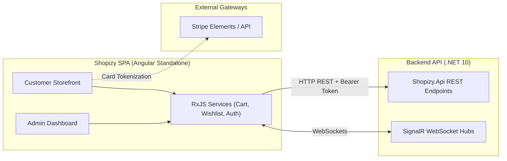

<div align="center">

# 🛍️ Shopizy SPA

### Modern, responsive e-commerce Single Page Application (SPA) built with Angular Standalone, Tailwind CSS, Stripe, and SignalR

[](https://angular.dev/)
[](https://www.typescriptlang.org/)
[](https://tailwindcss.com/)
[](https://playwright.dev/)
[](https://stripe.com/)
[](https://dotnet.microsoft.com/)
[](LICENSE)

[Overview](#-overview) •
[Features](#-key-features) •
[Architecture](#-architecture) •
[Tech Stack](#-tech-stack) •
[Repository Layout](#-repository-layout) •
[Quick Start](#-quick-start) •
[Testing](#-testing) •
[Documentation](#-documentation)

</div>

---

## 📌 Overview

**Shopizy SPA** is a high-performance customer storefront and administrative management application powering the Shopizy e-commerce ecosystem. Built with Angular Standalone Architecture, Tailwind CSS, Stripe Elements, and Microsoft SignalR, it provides a seamless shopping experience with real-time order tracking, reactive cart management, and multi-persona authentication.

### Key Highlights
- 🛍️ **Reactive Shopping Experience**: Instant cart updates, faceted catalog filtering (category trees, brands, price ranges), debounced search, and wishlist integration.
- 💳 **Stripe Elements Checkout**: Multi-step checkout with saved shipping addresses, dynamic carrier estimates, and client-secret authorized Stripe card validation.
- 📡 **Real-Time Order Telemetry**: Live order tracking status updates (`Pending` -> `Confirmed` -> `Shipped` -> `Delivered`) and admin KPI metrics pushed via SignalR WebSockets.
- ⚡ **Admin Management Suite**: Full product CRUD, category hierarchy editor, order fulfillment operations, and customer analytics.
- 🎭 **Multi-Persona E2E Automation**: Playwright test suites validating Customer, Admin, and Guest journeys with cached auth states.

---

## 🏛 Architecture



> [!NOTE]
> HTTP interceptors manage silent JWT refresh on 401 responses, ensuring uninterrupted browsing and administrative sessions.

---

## 🛠 Tech Stack

| Domain | Technologies |
| :--- | :--- |
| **Framework** | Angular (Standalone Components, Signals, Reactive Forms, Route Resolvers) |
| **Styling & UI** | Tailwind CSS, Custom SVG Sprite Sheet system |
| **State Management** | RxJS reactive streams and behavior subjects |
| **Real-time WebSockets** | `@microsoft/signalr` |
| **Payment Gateway** | `ngx-stripe` (Stripe Elements) |
| **Authentication** | `@auth0/angular-jwt` (JWT token decoding and expiration handling) |
| **Testing** | Playwright (E2E), Karma & Jasmine (Unit tests) |

---

## 📂 Repository Layout

```text
├── e2e/                           # Playwright E2E suites (customer, admin, guest personas)
├── docs/                          # In-depth architectural & testing documentation
│   ├── ARCHITECTURE.md            # Technical design, data flows, and interceptors
│   └── E2E_TESTING_GUIDE.md       # Playwright configuration and multi-persona setup
├── public/                        # Static assets and icons.svg sprite sheet
├── src/
│   ├── app/
│   │   ├── api/                   # Typed REST API service layer
│   │   ├── components/            # Standalone UI components (Storefront, Admin, Auth)
│   │   ├── guards/                # Route guards (AuthGuard with role verification)
│   │   ├── interceptors/          # Interceptors (Bearer token, 401 Silent Refresh, Errors)
│   │   ├── models/                # Domain models, entities, and TypeScript DTOs
│   │   ├── resolvers/             # Route data pre-fetching resolvers
│   │   └── services/              # State & business services (Cart, Wishlist, SignalR)
│   ├── environments/              # Environment configurations
│   └── styles.css                 # Tailwind CSS directives
├── playwright.config.ts           # Playwright test configuration
└── package.json                   # Dependencies and scripts
```

---

## 🚀 Quick Start

### Prerequisites
- Node.js 20+
- npm 9+
- Running backend API (e.g. `http://localhost:18080`)

### 1. Clone & Install
```bash
git clone https://github.com/akazad13/shopizy-spa.git
cd shopizy-spa
npm install
```

### 2. Configure Environment
Update API endpoint in `src/environments/environment.development.ts`:
```typescript
export const environment = {
  apiUrl: 'http://localhost:18080',
  production: false
};
```

### 3. Start Development Server
```bash
npm start
```
Navigate to `http://localhost:4200/`.

---

## 🧪 Testing

| Test Suite | Scope | Command |
| :--- | :--- | :--- |
| **Unit Tests** | Component logic, pipes, and API services (Karma / Jasmine) | `npm test` |
| **Code Linting** | ESLint static code analysis | `npm run lint` |
| **All E2E Tests** | Headless Playwright tests across all personas | `npm run test:e2e` |
| **Customer Journey** | Customer browsing and checkout flows | `npx playwright test --project=user-chrome` |
| **Admin Journey** | Admin dashboard and catalog fulfillment | `npx playwright test --project=admin-chrome` |

---

## 📚 Documentation

| Guide | Focus |
| :--- | :--- |
| 🏛️ [docs/ARCHITECTURE.md](docs/ARCHITECTURE.md) | Standalone routing, JWT silent refresh interceptors, and state architecture |
| 🧪 [docs/E2E_TESTING_GUIDE.md](docs/E2E_TESTING_GUIDE.md) | Multi-persona Playwright test fixtures and auth setup |
| 🎨 [ICONS_GUIDE.md](ICONS_GUIDE.md) | Built-in SVG sprite catalog and `<app-icon>` usage |

---

## 🤖 AI-Driven Development & Contributing

Autonomous coding agents (Antigravity, Cursor, Claude Code, GitHub Copilot) operating in this repository must consult [AGENTS.md](AGENTS.md) for Angular standalone component patterns, zero-secret environment guidelines, and Playwright multi-persona E2E requirements.

---

## 👤 Author

**Md. Abul Kalam**
- GitHub: [@akazad13](https://github.com/akazad13)
- LinkedIn: [Md. Abul Kalam](https://linkedin.com/in/akazad13)

---

## 📄 License

This project is licensed under the [MIT License](LICENSE).
